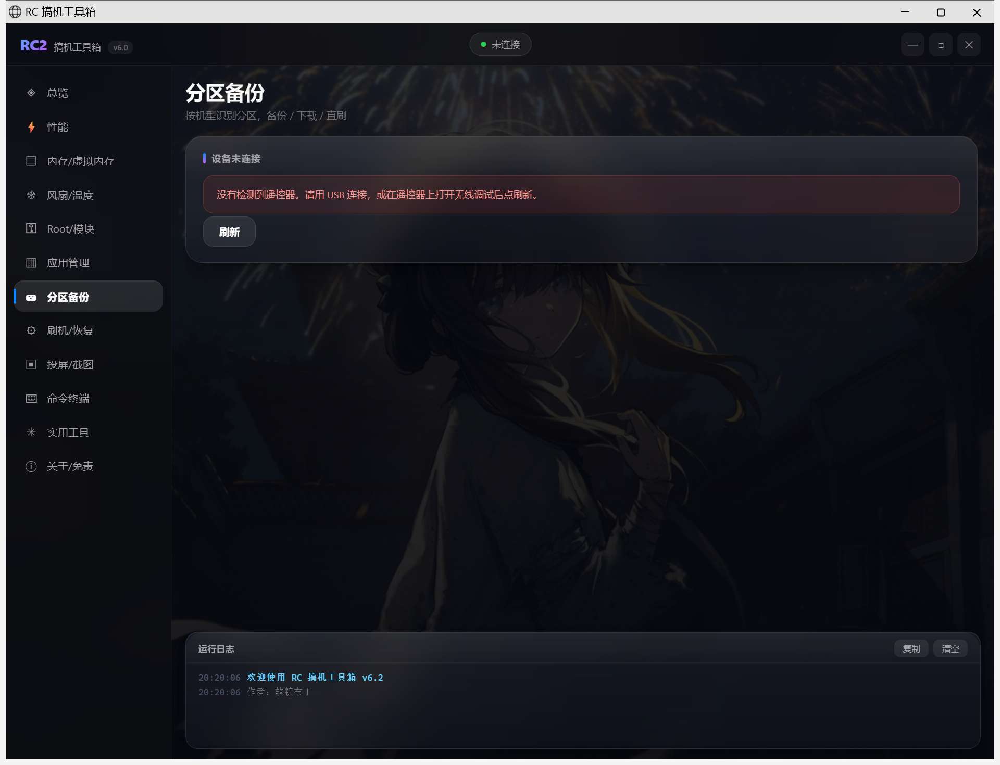
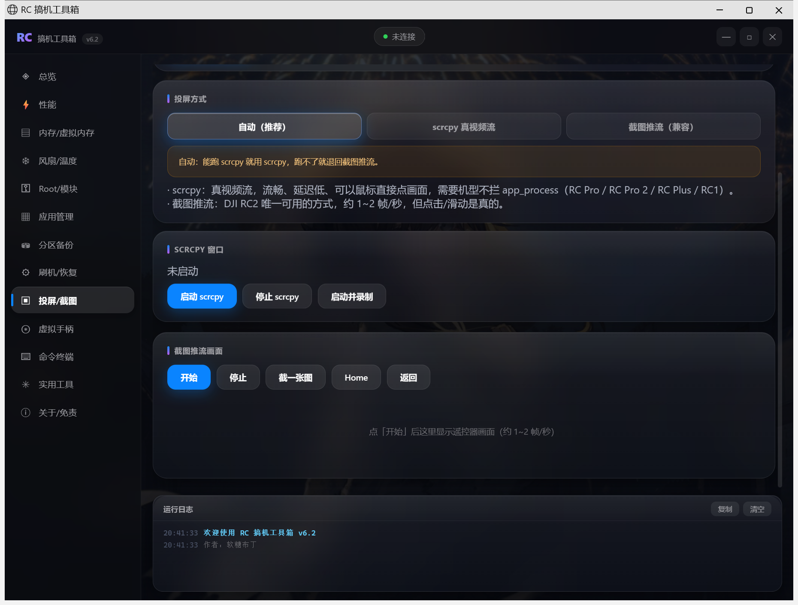
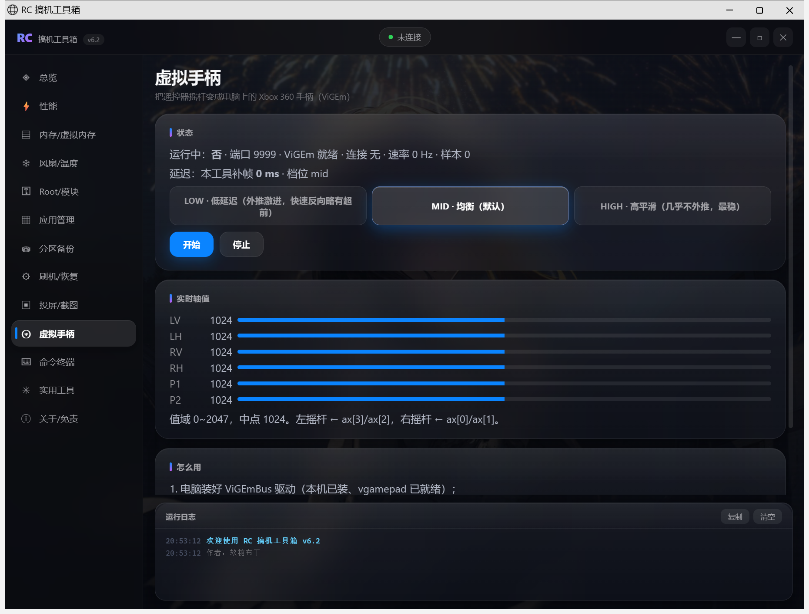

# RC 搞机工具箱

Windows 上用的一个小工具。插一根 USB 线，DJI 遥控器就当安卓机使。

能看分区、把 14 个分区挨个备份出来、原样刷回去、投屏上点着操作、读无人机的飞控参数。

[](https://github.com/456erddgr/rc-gaoji-toolbox/releases/latest)
[](https://github.com/456erddgr/rc-gaoji-toolbox/releases)
[](https://github.com/456erddgr/rc-gaoji-toolbox/stargazers)
[](#)
[](LICENSE)

root 怎么来的不在这儿，在另一个仓库：[rc2-unlock-toolkit](https://github.com/456erddgr/rc2-unlock-toolkit)。
这边只管一件事：你已经能进 root 了，接下来想干什么。

**[下 v6.21](https://github.com/456erddgr/rc-gaoji-toolbox/releases/latest)** · [旧版本](https://github.com/456erddgr/rc-gaoji-toolbox/releases) · [提 issue](https://github.com/456erddgr/rc-gaoji-toolbox/issues) · [支持哪些遥控器](#机型支持) · [图文教程](#图文教程)

## 动手之前

这软件手里有 adb 和 root。它能改 CPU/GPU 频率、改温控、动 zram 和 swap、往分区里写镜像、
刷 Magisk 模块、换开机动画、改飞控参数。任何一项搞错，遥控器都可能黑屏、变砖、丢数据，保修也没了。

不是吓唬你，这几个坑我们都踩过：

- 有一次把背光的 pwm 通道 unexport 了，屏幕当场黑掉，最后靠 `fix_screen.sh` 救回来。那之后这条写死在代码注释里：**pwmchip0 别碰**。
- swap 文件要是在开机时重建，2046MB 得写 89 秒，而这机器撑到 56 秒就死机了。所以现在只在开机后建。
- 我以为 `input tap` 能点屏幕，试了两天，rc 返回 0、截图 diff 全是 0。这机器的触摸得直接往 `/dev/input/event2` 写事件。

所以顺序是：先「分区备份」，14 个分区拉下来，再动别的。每个会写系统的按钮旁边都写了后果，别不看。

有三件事我们不干，也不假装干：**改固件、去限飞、改发射功率**。DJI 的固件包是签过名的，重签不了。

## 下载

新版本先发 GitHub：

| 文件 | 大小 | |
| --- | --- | --- |
| [`RCGaojiToolbox-Setup-6.21.exe`](https://github.com/456erddgr/rc-gaoji-toolbox/releases/download/v6.21/RCGaojiToolbox-Setup-6.21.exe) | 96 MB | 安装程序。ViGEmBus 和 DJI 的 USB 驱动都在里面，装完就能用 |
| [`RCGaojiToolbox-6.21.exe`](https://github.com/456erddgr/rc-gaoji-toolbox/releases/download/v6.21/RCGaojiToolbox-6.21.exe) | 32 MB | 绿色版。不写注册表，但驱动得自己装 |
| [`RC2-RemoteToolbox-2.29.apk`](https://github.com/456erddgr/rc-gaoji-toolbox/releases/download/v6.16/RC2-RemoteToolbox-2.29.apk) | 398 KB | 遥控器版，`adb install` 进遥控器 |

连不上 GitHub 就用网盘：**[123 云盘](https://1843626542.share.123pan.cn/123pan/VX07Td-v8SoA?pwd=nRmH#)**，提取码 `nRmH`。同一批文件，免登录不限速。
网盘会比 GitHub 慢一两天，新版本一般先在这儿发。

## 机型支持

| 机型 | 型号 | 平台 | 识别 | adb 备份/直刷 | fastboot 刷写 |
| --- | --- | --- | --- | --- | --- |
| DJI RC 2 | rc331 | 骁龙 778G (lahaina) | ✅ | ✅（有 root 时） | ✅（BL 已解锁） |
| DJI RC Pro | RM510 | 骁龙 865 (kona) | ✅ | 需先有 root | BL 通常锁定，只能 getvar |
| DJI RC | RM520/RM500 | 骁龙 845 | ✅ | 需先有 root | ✅（BL 已解锁） |
| DJI RC Plus | RM700/RM701 | 骁龙 865 | ✅ | 需先有 root | BL 通常锁定 |
| DJI RC Pro 2 | RM510B/RM530 | 骁龙 8 Gen1 | ✅ | 需先有 root | BL 通常锁定 |

所有机型都是**先探测再下结论**：分区目录、root 在不在、BL 锁没锁，全在运行时实测。
某个能力不具备时，软件会直接告诉你中文原因，不会给你一个空列表假装「功能坏了」。

## 这几个月改了什么

### v6.21 换皮：去掉 AI 味

这一版没加功能，专门收拾界面。原来那三个"一眼 AI"的写法都拆了：

| 原来 | 现在 |
| --- | --- |
| 导航拿 unicode 字形当图标（`⚡ ✳ ▤ ❄`） | 同一套 24×24 线性 SVG，`stroke-width 1.6`、圆头，颜色跟着文字走 |
| 卡片标题前面一条蓝紫渐变小竖条 | 删掉。层级靠字重和字距，不靠装饰色块 |
| 面板对角渐变底 + 彩色描边 | 扁平表面 + 发丝描边（`#23252a`）+ 单一强调色 `#5e6ad2` |

顺手收拾的：没连设备时 `- MHz`、`- %` 这类空值原来是绿的红的，现在统一压成灰 —— 颜色只留给真数据；"实时状态"底下那根多余横向滚动条也没了。

背景还是留着的（你要的通透感），只给壁纸加了 13px 虚化 + 压暗，正文不再被花纹抢。

动效只有一处：切页时内容逐条上浮淡入（8px、每条错开 34ms、共 520ms）。系统开了"减少动态效果"就全关。

遥控器版同时升到 **v2.29**，用的是同一套配色（注意：这块只有编译验证，当时遥控器没插，没有真机截图）。

### v6.20 切槽一键化

上一版切槽要按三步（进 Fastboot → 切槽 → 重启），这版合成一个按钮。

| 按钮 | 干什么 |
| --- | --- |
| 一键切到 A 槽（重启→切槽→重启） | `reboot bootloader` → 等 fastboot（最多 90 秒）→ `set_active a` → `fastboot reboot` |
| 一键切回 B 槽 | 同上，目标 b |

实机链路（2026-11-05，目标 b）：`Setting current slot to 'b'  OKAY [0.005s]` → 回读 b → 重启 60 秒后 `sys.boot_completed=1`、`slot_suffix=_b`。

顺带把鸿蒙移植的思路摸清了，写在仓库外的 `RC2-鸿蒙移植思路与可行性.md`：那个 sheng（小米平板 6S Pro）项目是「华为系统盘 + 小米启动链 + 自写兼容垫片」，**仓库里没有系统本体**，donor 要自己从真华为平板 dump；RC2 的内核是 DJI 5.4.210、内存 1.71 GB，所以现在不假装能刷。

### v6.19 切槽：A/B 双系统一句话换

这台遥控器本来就带 A/B 两个系统槽，平时只有一个在用（现在用的是 b）。ABL 原本拿它做 OTA 回滚，但它也能当"第二系统"的开关：Android 留在 b，别的系统放 a，切槽就等于切系统。

「刷机 / 恢复」页多了一张 **系统槽位（A/B 双系统）** 卡片，按钮是「刷新 / 进入 Fastboot / 切到 A 槽 / 切到 B 槽 / 从 FB 重启」。

实机跑过的完整链路（2026-11-05）：

1. 系统里点「进入 Fastboot」→ 25 秒后状态变 `mode=fastboot`；
2. 「切到 A 槽」→ `Setting current slot to 'a'  OKAY [0.019s]`，回读 `current=a`；
3. 再「切到 B 槽」→ 回读 `current=b`；
4. 「从 FB 重启」→ 约 55 秒回安卓，`sys.boot_completed=1`、`slot_suffix=_b`。

为什么只能在 Fastboot 里切，两条都实测过：系统里没有 `bootctl`（`/system/bin/sh: bootctl: inaccessible or not found`）；`misc` 偏移 2048 的 AOSP `slot_suffix` 在这台机器上是空的，高通 ABL 不读它。

切坏了不会变砖：实测把 a 槽刷成一个起不来的镜像，ABL 试 a 失败后自己回退到 b，安卓照常启动。

### v6.18 外观自己调：背景通透度 / 磨砂度

上一版壁纸被压得只剩一层灰，玻璃后面什么都看不见。这版把三件事做成滑杆，存在浏览器里，下次打开还是你调的样子：

| 滑杆 | 管什么 | 默认 |
| --- | --- | --- |
| 背景通透度 | 壁纸上面那层暗色蒙版的浓度，0% 完全不管、70% 压到发黑 | 26% |
| 玻璃磨砂 | `backdrop-filter` 的模糊半径，0 是完全透明玻璃、44px 是毛玻璃块 | 24px |
| 玻璃暗度 | 面板自己那层底色的不透明度，调低就通透、调高就沉 | 62% |
| 壁纸亮度 | 壁纸本身的 `brightness`，暗壁纸可以往上推，亮壁纸往下压 | 1.04× |

标题栏右上角那个 **◐** 就是入口，「恢复默认」一键还原。默认值比上一版通透得多：蒙版从 `.30/.48/.66` 松到 `.12/.20/.26` 的量级，壁纸该亮就亮。

技术上就三个 CSS 变量在跑：`--wp-dim-a/b/c`（蒙版三段）、`--lg-blur`（磨砂）、`--panel-a`（面板底色）。滑杆只改变量，不重绘 DOM，拖动是即时的。

### v6.17 界面重做：液态玻璃 + 自己的弹窗

界面这一层原来很糙：面板是一块半透明矩形，壁纸被压成灰板，控件全是浏览器默认样式。这版重做了。

玻璃怎么做的：面板底是磨砂（`backdrop-filter: blur(22px) saturate(1.75) brightness(1.06)`），边框那圈另铺一层 SVG `feDisplacementMap` 想做出折射，再叠一道跟着鼠标走的镜面高光。磨砂和高光都稳；折射这层在 Edge 里能跑（`getComputedStyle` 读得到 `url("#rcLgRefract")`），但**底色一平就看不出来**，所以现在的实际观感主要来自磨砂 + 边框 + 高光。壁纸换成花的，边缘弯曲才明显。

顺手把壁纸的压暗从 `.55→.72` 松到 `.30→.48→.66`，不然玻璃后面什么都看不见。

弹窗：原来点「修改」弹的是浏览器原生 `prompt`，在 Edge 应用窗口里样式控不住，**关键是输入框拿不到焦点，0 改不了**。现在换了自己的：

- 大号数字居中，右边跟单位，`−` / `+` 步进，↑↓ 也能加减
- 上下限按参数表校验，超了直接提示；**0 是合法值**，不会被 `value || 默认值` 这种写法吞掉
- Enter 确定，Esc 取消
- 危险动作（ADB root、擦除、重启）走红色确认，正文里把后果写清楚

代码里 15 处 `confirm()`、2 处 `prompt()` 全换掉了，不再调用浏览器对话框。

做的时候踩了一个坑记着：弹窗 `build()` 时把输入框 append 进了正文容器，`open()` 里 `innerHTML = ''` 清正文，把输入框一起删了 —— 表现为「弹窗只有标题和按钮，输入框不见」。修法是清完正文重新 append 回来。

### v6.16 虚拟手柄：先修一个一直没发现的 bug

虚拟手柄有个老毛病：连上了，但一动不动。`pad_status` 里 `count=0`、`peer=""`。

查了很久，最后发现跟算法一点关系都没有，是监听循环的写法：

```python
srv.settimeout(0.5)
...
except Exception:
    break      # socket.timeout 也是 Exception，于是半秒没人连，监听线程就自杀了
```

线程一退，内核照样把三次握手做完（连接躺在 backlog 里），但永远没人去 `recv`。
`netstat` 看到的是 `LISTENING` 加一堆 `CLOSE_WAIT`，看着像「连上了」，其实是死的。

改一行就好：`except socket.timeout: continue`。改完当场 `count=48 / push_hz=227.1 / hz=9.55`。

然后才是算法。老代码是三点外推：`OVER=1.25` 允许 25% 过冲，`cap = abs(step)*0.25 + 6` 这个钳制基本没起作用。
摇杆源最快就 9.6Hz（实测 median 102ms 一帧），于是外推冲出去、回拉、冻住、下一个点再瞬移，
偶尔 `age > 135ms` 还会直接回中。离线对拍量出来：单拍最大跳变 **539.3**。

你说「OpenRC2 那个遥感监测很流畅」，我去把它拆了。有意思的是它 **1.41 → 1.42 恰好把三点外推删了**，
源码注释写得很直白：会冲出、会打回。它靠的是帧间线性插值（窗口 20~45ms，走完停在真值上）加三段低通。

我们就照这个改：

| 机制 | 参考实现 | 我们 |
| --- | --- | --- |
| 帧间线性插值，窗口 20~45ms，走完停在真值 | `StickSmooth.java:221-256` | `_value()`：窗口钳 [20,60]，`u>=1` 直接返回最新真值 |
| 三段低通：`dd<0.004` 或 `dd>0.05` 直通，中间 `+=0.80` | `StickSmooth.java:183-188` | `_lowpass()`：同口径，零滞后但小抖不抖 |
| 三层频率解耦：9.6Hz → 控制 100Hz → 推 PC 250Hz → UI | `Radio.java:20` / `PadStream.java:26` / `RadioView.java:59` | 控制环 10ms 算低通，推流环 4ms 发手柄 |
| 断流 250ms 重置历史，不拿旧值插值 | `StickSmooth.java:147` | `GAP_RESET_MS = 250` |
| 快照原子发布，避免撕裂 | `volatile int[]` 整体换引用 | `_feed()` 整帧换引用 |
| 高精度定时器 | 安卓 HandlerThread | `timeBeginPeriod(1)`（以前没有，实际是 15.6ms 抖动） |

真 ViGEm 手柄，源 9.6Hz 推 5 秒：

- 推流 **227Hz**（间隔 median 4.38ms，p99 5.00ms）
- **单拍最大跳变 539 → 70.7**（p99 59.6），加速度尖峰 260 → 9.70

三档可以现场切：

| 档位 | 窗口 | 单拍最大跳变 | 与真值错位 |
| --- | --- | --- | --- |
| 低延迟 | 35ms | 169 | 107ms |
| **均衡（默认）** | 60ms | **98.4** | 124ms |
| 高平滑 | 90ms | 65.6 | 142ms |

两句实话：

- 遥控器端 `toolbox2` **还没有 9999 发送端**（只有 40007 读、40008 注入）。现在能跑的是「遥控器上的 ETX 推流 + 我们 PC 端平滑」。
- 40007 的 9~10Hz 是物理上限。UDP 40009、binder、`/dev/input` 都试过，没找到更高频的旁路。

### v6.15 参数表：之前一直在调别人飞机的参数

用户反馈「显示未识别到飞机 / 能连上但调不出数据」。查到最后是个挺蠢的原因：内置的参数表是另一台飞机的。

- 你的飞机（Mini 4 Pro）回表属性 `crc = 0xB9B2B16E`，条数 `1433`
- 我们内置的 `dji_params.json` 是 Lito X1，`crc = 0x5F8B2AE1`，条数 `1593`
- 索引全错位。同一个 index 在两张表里是完全不同的参数，读回来是乱值，写进去更危险

改法：

1. **内置 14 张机型表**：Mini 4 Pro / Mini 3 Pro / Mini 5 Pro / Air 2S / Air 3 / Air 3S / Mavic 3 / Mavic 3 Pro / Mavic 4 / Neo / Neo 2 / Flip / Avata 360 / 通用表。
2. **连上先读机型**：发 `0xE0` 拿 `(crc, 条数)`，两个都对上才用；不确定就明说「按通用表」，不猜。
3. **按名字解析索引**：开关、滑块、FCC、恢复出厂，全部先拿参数名去当前机型表里查；查不到就拒绝写，并说明原因。
4. **缺项如实列**：你这台的表里没有的 7 项（`EU_CE_Reg_MxSpeedLimit_Enable`、`support_unlimit_height` 等）会单独列在「本机型不适用的项」，不给假开关。
5. **连接体检**：调参前检查 `dji_link` 在不在、DJI Fly 开没开、EdgeTX 有没有占着 40007。
6. **写前核对名字**：先用 4 字节 `0xE1` 把板子上的名字读回来比对（板子回的是 `短名|全名`，只比 `|` 前面那半），名字不一致直接拒写。

遥控器版 v2.28 是同一个根因，一起修了：

- **页面能滑了**。之前整个内容区是裸 `LinearLayout`，没有 `ScrollView`，79 行内容卡在屏幕上动不了。
- **不再写错参数**。原来把 `ce_country_type` 写死在 index 239（Lito X1 的位置），Mini 4 Pro 是 509。
- **名字核对终于生效**。`getInfoName()` 以前发 6 字节 payload，这飞控只认 4 字节，多出来的被静默忽略，所以核对等于没做。

这一版构建、安装、API、离线选表都验过了。但当时飞机是关着的，所以「开关真读真写 / 恢复出厂 / 切 FCC 回读」还得等飞机开机对频再跑一遍。

### v6.14 调参页合并成一个

侧边栏里「电脑调参」和「简易调参」原来分两页，现在并成一页，三个标签：

| 标签 | 干什么 |
| --- | --- |
| 连接飞机 | 飞机 USB 直插电脑就能读写参数（不用遥控器、不用在遥控器装 App） |
| 简易调参 | 59 个开关 + 20 个滑块，分 12 组。一点就开，一关就关，一拉就变 |
| 全部参数 | 952 条飞控参数，能搜、能筛、能批量读写 |

参数表来自 MIT 项目 [djiparam](https://github.com/lmdegreeds/djiparam) v0.16。它原始分类是俄文的，
所以这边自己做了中文词表：15 类分类映射、535 个词条，加上常用短语。查残留英文的时候把 FCC/CE/LED/GPS/ATTI/RID
这些本来就该留的缩写剥掉再看，剩 0 条。

**FCC 那栏**：一键切美国 FCC(840) / 中国香港(344) / 俄罗斯(643)，写的是 `ce_country_type` 这个 ISO 国家码参数。
写不写得动看固件和飞机自己怎么判，工具写完会回读，显示实际值，你自己看。**工具不改固件、不伪造签名。**

**恢复出厂**：逐项读回当前值，只把和默认值不一样的写回去，然后告诉你写了几项、几项本来就是默认、几项失败、几项没默认值跳过。
只碰飞控参数，不碰激活状态、账号、校准数据。

两处得说清楚：`max_height` 这个参数原表里根本不存在，只能用 `g_config.flying_limit.max_height` 顶（记在 `fc_extras.MISSING_REQUIRED` 里）；
`EU_CE_Reg_MxSpeedLimit_Enable` 的 `min=0/max=0`，没声明可写范围，标成高风险，写完必须回读。

**滑块不再写坏小数**：原来 1000 格线性映射，F32 参数一格就是 0.08，`brake_sensitive_fc` 默认 0.6，手一抖就变 0.64。
现在步长按类型来（F32 用 0.01/0.05，整数至少 1），总量不超过 2000 格，写之前先读回比对，差不到一格就跳过。

### 更早的几个版本

**v6.10**：飞机直连电脑 + 固件仓库加了飞机。实测更正过一次——飞机在 Windows 上不是串口设备
（注册表 `SERIALCOMM` 里只有蓝牙 COM），是 `VID_2CA3&PID_0020` 的复合设备（MI_02 是大容量存储，MI_03~MI_07 是 libusb-win32），
走 libusb bulk。所以「扫描串口」那条路在真机上找不到飞机，工具会如实报错。稳定能用的还是「经遥控器 DUML 回环口」，
而且要求遥控器上 DJI Fly 已经连上飞机。固件仓库列 160 个机型条目，数据源是第三方归档站 DDD，不是 DJI 官方。

**v6.5**：FPV 调参 + 驱动内置。死区、EXP 曲线、油门限位、一键自检。摇杆数据上限实测 8.85Hz，这是设备限制。
安装包内置 ViGEmBus 1.22.0 和 DJI 的 `Drivers_Win10`；`--drivers` 会弹 UAC 跑 `pnputil /add-driver ... /install`。

**v6.4**：遥控器调参和固件信息。调参项都能回读、能还原，原值记在 `out/rctune/orig.json`。
固件这块得说明白：DJI 的固件是签名包，第三方重签不了，所以不代刷。我们只做三件事——显示当前机型和固件版本、
一键打开对应机型的官方下载页、校验你手上的包（大小 / sha256 / 头部 magic）。
官方接口 `firmware-dl.djicorp.com` 在我们这边 DNS 解析不出来（2026-11-02 实测），所以也没走「直接拉列表」那条路。

## 两个基础功能

### 分区备份

- 按机型列出真实分区表，带每个分区的字节数
- 单分区下载：`dd bs=4096 count=<精确块数>` → 校验大小 → `sha256sum` → `adb pull` → 本地再校验一次
- 每个镜像旁边生成同名 `.sha256`，以后随时能验有没有坏
- 批量时只备份该机型的关键分区（RC2 有 `dji_apk`，RC Pro 没有）

### ADB 直刷

需要 root。流程是：自动备份原分区 → 校验镜像大小必须等于分区大小 → `dd conv=fsync` 写入 → 回读 sha256 比对 →
不一致就自动刷回备份。大小对不上直接拒绝，不会写一半。

其它页面：总览、性能、内存与虚拟内存、风扇温度、Root 与模块、应用管理、刷机恢复（Fastboot + Magisk 刷 Root 四步）、
投屏与点击、命令终端、实用工具。

## 为什么投屏只有一两帧

DJI 的 ROM 从 SELinux 那层就把 `app_process` 拦了，scrcpy 的服务端起不来。
实测连 `app_process /system/bin T` 都跑不出任何输出，不是配置问题，是硬堵。

所以 RC2 只能 `adb exec-out screencap -p` 逐帧推 PNG，0.5~1 秒一帧。看着卡，但**点击和滑动是真的**：
直接往 `/dev/input/event2`（himax-touchscreen）写 `sendevent`，坐标映射 `tx = y_disp, ty = 1919 - x_disp`。
这是试出来的唯一正确映射，`input tap` 在这机器上被静默吞掉。

## 图文教程

### 一、分区备份



1. USB 连上遥控器，确认「设备状态」显示已连接、有 root
2. 进「分区备份」页，会按机型自动列出分区（带大小）
3. 点某个分区的「备份」，写到遥控器 `/data/local/tmp/rc2part/`，再用「下载」拉到电脑
4. 每个备份都会生成同名 `.sha256`

### 二、ADB 直刷

同一个分区行点「刷入」，选镜像。工具会先自动备份，校验「镜像大小 == 分区大小」，写入，回读 sha256，不一致就刷回备份。

### 三、投屏



- **scrcpy 真视频流**：RC Pro / RC Pro 2 / RC Plus / RC1 能用（这些机型不拦 `app_process`）
- **截图推流**：RC2 只能这个，1~2 帧/秒，但点击滑动是真注入
- 「自动」模式会先探测，能 scrcpy 就用 scrcpy，不能就退回来

### 四、虚拟手柄



1. 装 ViGEmBus（安装程序会检测，没有会给下载地址）
2. 点「开始」，自动 `adb reverse tcp:9999 tcp:9999` 并监听 `127.0.0.1:9999`
3. 遥控器端把摇杆流指向 `127.0.0.1:9999`，每行一个 JSON：`{"ax":[1024,1024,1024,1024,1024,1024]}`
4. 电脑上多出一个 Xbox 360 手柄，游戏里直接用
5. 延迟档位 LOW / MID / HIGH，源是 9~10Hz 的 DUML 摇杆帧，一拍约 100ms

### 五、ADB Root

「Root/模块」页的「ADB Root」卡。开启后把 `adbd-root` 和注入脚本推到 `/data/adb-persist/rc-adbroot` 执行，
让 adbd 以 root 身份跑（`--root_seclabel=u:r:su:s0`）。不动 boot、dji_apk、super 任何一个分区，「恢复」一键回原状。

## 代码结构

```
app/           引擎与功能（engine / devices / partops / features / fcparam / fcquick / fc_models / duml）
main_api.py    给界面的 HTTP API
server.py      本地 HTTP 服务（只监听 127.0.0.1）
run_app.py     启动器：tkinter 无边框宿主 + Edge --app 内嵌（去标题栏/白边）
ui/            HTML/CSS/JS 界面（真 backdrop-filter 液态玻璃）
installer/     安装程序（纯 tkinter，不依赖浏览器）
build_v4.spec  主程序打包配置
build_installer.spec  安装包配置
```

## 自己编译

```bat
python -m PyInstaller build_v4.spec --noconfirm
copy dist\RC搞机工具箱.exe payload_build\RCGaojiToolbox.exe
python -m PyInstaller build_installer.spec --noconfirm
```

Python 3.12 + PyInstaller 6.x。跑起来要 Microsoft Edge（Win10/11 自带）。

## 已知限制

- 投屏是截图推流，不是 60fps。原因见上面，不是没优化
- 没有 root 又锁了 BL 的机型（比如没解锁的 RC Pro）只能查询，不能备份和刷写。这是设备限制
- RC 系列 fastboot 基本只写不读（`fetch` / `oem dump` / `get_staged` 全 unknown command），抽不了镜像
- 飞机 USB 直连（libusb bulk）还没跑通，暂时只能走经遥控器的 DUML 回环口
- 不提供「回锁 BL」。DJI 遥控器回锁直接变砖，这个功能我们主动删了

## 许可

代码是 MIT，见 [LICENSE](LICENSE)。改、发、商用都行，出问题自己扛。

安装包里塞了两个别人的东西：

- **ViGEmBus**：BSD-3-Clause，Nefarius 写的。虚拟手柄全靠它
- **DJI 的 USB 驱动**：大疆的，原样附带，一个字节没改

固件仓库里下的固件包也是大疆的。我们只负责下下来、对一下 SHA256，不重签、不改包。

第三方的东西有异议，提 issue，拿掉就是。

---

## 免责声明

非官方工具，与 DJI 无任何关系。改机有风险，后果自负。先把分区备份了，再动手。